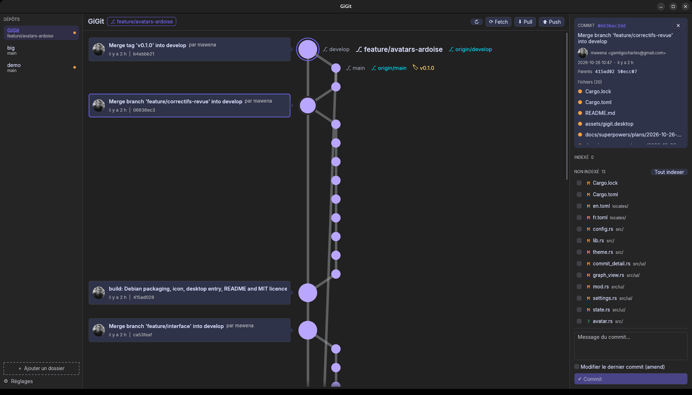

# GiGit

**Un client git graphique, rapide et convivial, écrit en Rust et inspiré d'[ungit](https://github.com/FredrikNoren/ungit).**

GiGit est une vraie application de bureau. Tes dépôts restent listés sur le côté : un clic suffit pour passer de l'un à l'autre, sans terminal ni navigateur.



*[English version below](#english)*

---

## Fonctionnalités (v0.1)

- **Liste de dépôts persistante.** Ajoute ou retire des dossiers quand tu veux (retirer un dépôt ne supprime jamais rien sur le disque) et réordonne-les par glisser-déposer. Chaque dépôt affiche sa branche, ses modifications en cours et ses commits en avance ou en retard.
- **Graphe des commits façon ungit.**
  - La ligne principale part de HEAD, avec une carte pour chaque commit.
  - Les autres branches ont chacune leur colonne.
  - Le nom des branches et des tags est écrit à côté des nœuds.
  - L'historique se charge par pages, ce qui garde GiGit fluide même sur les gros dépôts.
- **Détail d'un commit** : message, auteur, date, parents cliquables, fichiers modifiés et leur diff.
- **Indexation précise.**
  - Coche un fichier pour l'indexer, ou sélectionne seulement certains **blocs** ou **lignes** du diff. Shift+clic sélectionne une plage de lignes.
  - GiGit utilise le vrai index git : ce que tu indexes dans un terminal apparaît dans GiGit, et inversement.
- **Commit et amend.** `Ctrl+Entrée` valide le commit. L'amend reprend le message du dernier commit.
- **Annulation de modifications** (fichier, bloc ou ligne), toujours après confirmation.
- **Ajout au `.gitignore`** depuis un clic droit sur un fichier.
- **Fetch, pull, push** et push forcé (avec confirmation). Le push forcé utilise `--force-with-lease --force-if-includes` et refuse d'écraser des commits distants que tu n'as pas intégrés. Un premier push crée automatiquement la branche distante.
- **Fetch automatique** du dépôt ouvert, toutes les 5 minutes par défaut et réglable.
- **Rafraîchissement automatique** : GiGit voit tout de suite les changements que tu fais dans ton éditeur ou ton terminal.
- **Français et anglais.** Par défaut, GiGit suit la langue du système.
- **Thèmes** : Sombre chaleureux (par défaut), Nuit, Clair ou Système.
- **Une seule fenêtre** : `gigit .` lancé depuis un terminal ouvre le dossier dans la fenêtre GiGit déjà ouverte.
- **Erreurs git claires.** Le message s'affiche dans un bandeau, et la commande comme la sortie complète restent consultables.

GiGit lance la commande `git` installée sur ta machine. Ta configuration, tes hooks, ton agent SSH et ton gestionnaire d'identifiants fonctionnent donc comme d'habitude.

### Prévu pour les prochaines versions

- **v0.2** : branches et tags (création, suppression, checkout), reset, glisser-déposer de branches comme dans ungit, merge, rebase, squash, cherry-pick, revert et résolution des conflits.
- **v0.3** : stash, sous-modules, gestion des remotes, clone, éditeur de `.gitignore`, diff d'images, saisie des mots de passe dans GiGit et raccourcis clavier.

> Tant que la fenêtre de saisie des mots de passe de GiGit n'est pas là (prévue en v0.3) :
> - un push ou un pull que tu lances utilise la fenêtre de mot de passe de ton bureau si tu en as une (par exemple sous KDE). Sinon, il échoue aussitôt avec un message clair ;
> - le fetch automatique ne demande jamais de mot de passe.
>
> En attendant, le plus simple est d'utiliser un agent SSH ou un gestionnaire d'identifiants git.

## Installation

### Paquet Debian / Ubuntu (recommandé)

Télécharge le `.deb` de la [dernière release](https://github.com/mawena/GiGit/releases/latest), puis installe-le :

```bash
wget https://github.com/mawena/GiGit/releases/download/v0.1.0/gigit_0.1.0-1_amd64.deb
sudo apt install ./gigit_0.1.0-1_amd64.deb
```

Pour désinstaller : `sudo apt remove gigit`. Tes réglages restent dans `~/.config/gigit/`.

GiGit apparaît ensuite dans le menu des applications (catégorie Développement).

### Depuis les sources

Il faut Rust 1.85 ou plus récent, git 2.43 ou plus récent, et les bibliothèques de développement GTK, X11 et Wayland habituelles d'egui.

```bash
cargo build --release
./target/release/gigit
```

Pour fabriquer le paquet `.deb` :

```bash
cargo install cargo-deb
cargo deb          # → target/debian/gigit_<version>-1_amd64.deb
```

## Utilisation

```bash
gigit              # ouvre le dernier dépôt consulté
gigit ~/mon/projet # ouvre (et ajoute à la liste) ce dossier
```

| Action | Comment |
|---|---|
| Ajouter un dépôt | « + Ajouter un dossier » en bas à gauche, ou `gigit <dossier>` |
| Retirer un dépôt | clic droit sur le dépôt → « Retirer de la liste » |
| Voir un commit | clic sur sa carte ou sur son nœud |
| Indexer un fichier | cocher sa case dans « Non indexé » |
| Indexer des lignes | ouvrir le fichier, cliquer sur les lignes, puis « Indexer les lignes » |
| Indexer un bloc | bouton « Indexer ce bloc », ou clic sur l'en-tête du bloc pour le sélectionner |
| Push forcé | clic droit sur « Push » |
| Réglages | « ⚙ Réglages » en bas à gauche |

Les réglages sont enregistrés dans `~/.config/gigit/config.toml`.

## Développement

Le projet suit **git flow** : `main` contient les versions publiées, `develop` sert à l'intégration, et chaque fonctionnalité passe par une branche `feature/*`.

```bash
cargo test                                  # tests unitaires et d'intégration (vrais dépôts temporaires)
cargo clippy --all-targets -- -D warnings
```

Organisation du code :

- `src/git/` : appels à la commande git et lecture de ses sorties (status, log, diff), construction des patchs pour l'indexation partielle, opérations.
- `src/graph.rs` : placement des nœuds du graphe façon ungit.
- `src/worker.rs` : un thread par dépôt ouvert, pour que l'interface ne se fige jamais.
- `src/ui/` : l'interface egui.
- `locales/` : les traductions.

## Licence

[MIT](LICENSE) © 2026 mawena.
La police [Inter](https://github.com/rsms/inter) est distribuée sous licence SIL Open Font License 1.1 (`assets/fonts/OFL.txt`).

---

## English

**GiGit is a fast, friendly graphical git client written in Rust, inspired by [ungit](https://github.com/FredrikNoren/ungit).**

It is a native desktop app with a persistent sidebar of repositories: one click switches between them, with no terminal and no browser involved.

### Features (v0.1)

- **Persistent repository list.**
  - Add or remove folders at any time. Removing a repository never touches the disk.
  - Reorder the list by drag and drop.
  - Each repository shows its branch, a dirty marker and its ahead/behind counts.
- **ungit-style commit graph.**
  - A main line from HEAD, with a card for each commit.
  - Each other branch gets its own column.
  - Branch and tag labels sit next to the nodes.
  - History loads in pages, so large repositories stay smooth.
- **Commit details**: message, author, date, clickable parents, changed files and their diffs.
- **Real-index staging.** Stage whole files, single **hunks** or individual **lines** (Shift+click selects a range).
- **Commit and amend** (`Ctrl+Enter` commits).
- **Discard** a file, a hunk or a line, always after a confirmation.
- **Add a file to `.gitignore`** from its right-click menu.
- **Fetch, pull, push** and force push (after a confirmation). Force push uses `--force-with-lease --force-if-includes` and never overwrites remote commits you have not integrated. A first push sets the upstream.
- **Automatic background fetch** of the open repository.
- **Auto-refresh** when files change on disk.
- **French and English** interface.
- **Themes**: Warm dark (default), Night, Light, or System.
- **Single window**: `gigit <folder>` opens the folder in the already running window.

GiGit runs your installed `git` binary, so your configuration, hooks, SSH agent and credential helpers just work.

### Install

Download the `.deb` from the [latest release](https://github.com/mawena/GiGit/releases/latest), then:

```bash
wget https://github.com/mawena/GiGit/releases/download/v0.1.0/gigit_0.1.0-1_amd64.deb
sudo apt install ./gigit_0.1.0-1_amd64.deb
```

To build from source, use `cargo build --release`. To build the Debian package, run `cargo install cargo-deb`, then `cargo deb`.

### License

[MIT](LICENSE) © 2026 mawena. The Inter font is licensed under the SIL Open Font License 1.1.
